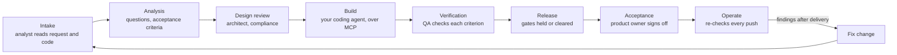

# Kryterea Lifecycle Copilot

**Claude and Codex build. Kryterea is the professional they build with.**

Coding agents write code fast. The rest of a delivery team gets skipped: the business analyst who asks what the change really needs, the architect who asks what happens at 2 a.m., QA who checks every acceptance criterion against the code, the compliance officer who reads the law, and the product owner who accepts the work. This copilot does those duties for every change your coding agent makes, on Meta's Muse Spark. It never writes product code and never writes to your repo.

Every change ends in an acceptance record you can put your name to: what was asked, what each professional found, every decision and who made it, and the evidence for each criterion. Work you can sign.

## How a change moves



Every path has an end:

| Situation | Where it ends |
|---|---|
| The analyst has questions | You answer them in the panel; a later round of questions opens again |
| A finding is raised | Fixed (confirmed by a re-check), accepted as a risk with a reason, or deferred with a reason. Deferring a legal finding keeps release held |
| The coding agent says it fixed something | The finding stays open until a completed re-check reads the flagged code and no longer raises it. A finding with no code location waits for a person to decide |
| No acceptance criteria were written | The change goes back to the analyst |
| The work will not ship | Withdraw it with a reason; it stops and the record says why |
| Something breaks after delivery | Open a fix change from the delivered one; it carries the findings through the gates again, and both records link to each other |
| The server restarts mid-run | Interrupted runs are closed on start, so nothing shows as working forever |

## Run it

Needs Node 22.13 or later and pnpm.

```bash
pnpm install
```

```bash
cp .env.example .env
```

To try it without a Meta key, set `COPILOT_FAKE_MODEL=1` in `.env`. The copilot then replays recorded Muse Spark runs and sends nothing to Meta. For live runs, set `META_API_KEY`. `COPILOT_BUDGET_USD` caps model spend (70 by default); the copilot stops calling the model once it is used.

```bash
pnpm dev
```

The API runs on http://localhost:8787 and the panel on http://localhost:5173. Add a project with a public GitHub repo URL, open a Baseline change, and press Run next step.

## Connect your coding agent

The copilot speaks MCP. Build it once (`pnpm -r build`), then add it to your agent. For Claude Code:

```bash
claude mcp add lifecycle-copilot -e COPILOT_URL=http://localhost:8787 -- node packages/mcp/dist/src/main.js
```

For OpenCode, Cline or any MCP client, run `node packages/mcp/dist/src/main.js` as a stdio server with `COPILOT_URL` set.

When a change reaches Build, the panel shows the project id and a prompt to paste into your agent. The tools:

| Tool | What the agent does with it |
|---|---|
| `list_findings` | Sees what the professionals raised |
| `get_finding` | Reads one finding, its evidence and its fix prompt |
| `get_change` | Sees the stage, gates and criteria of a change |
| `report_fix` | Says what it changed; the finding stays open until a re-check confirms it |
| `request_recheck` | Asks for a re-check against the latest commit |

## Where this sits in Kryterea

Kryterea is a platform for professional software delivery work: requirements, reviews and sign-off that teams and AI-native agencies can stand behind. This copilot is its delivery-lifecycle layer, built during the Meta hackathon as a standalone, open-source product. Next on the roadmap: Kryterea's own professional packs plugged in, named sign-off from a stakeholder register, and project archiving and deferral reviews handled by the Kryterea workspace.

What was built during the hackathon, and what came before it, is in [BUILT_DURING_HACKATHON.md](BUILT_DURING_HACKATHON.md).

## Notes

- Legal findings cite only the verified entries in `packs/legal/` and say "Check this". They are not legal advice.
- Tests: `pnpm test`. Types: `pnpm typecheck`.
- Licence: Apache 2.0.
