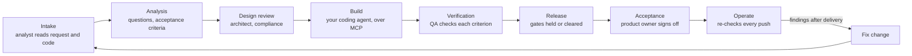

# Kryterea Lifecycle Copilot

**Claude and Codex build. Kryterea is the professional they build with.**

Coding agents write code fast. The rest of a delivery team gets skipped: the business analyst who asks what the change really needs, the architect who asks what happens at 2 a.m., QA who checks every acceptance criterion against the code, the compliance officer who reads the law, and the product owner who accepts the work. This copilot does those duties for every change your coding agent makes, on Meta's Muse Spark. It never writes product code and never writes to your repo.

Every change ends in an acceptance record you can put your name to: what was asked, what each professional found, every decision and who made it, and the evidence for each criterion. Work you can sign.

## The flow, in four acts

One path from a repo to a signed record, made for someone who is not an expert in any of these professions.

1. **Take.** Welcome, then your workspace. Link a repo and Kryterea names the project after it and shows back the files it picked up.
2. **Detect.** Say what is wrong in your own words. Kryterea decides which professions check it (Auto), or you pick them by hand. A profession you leave out shows Not checked and keeps release Held. Questions come in plain words with listed answers and a safe default; answer, or say "I don't know" and the default is recorded as assumed, with your name.
3. **Find and solve.** The assessment starts with your problem, then what else was found. The product owner writes the changes for you. You approve one into a fix change with acceptance criteria, or accept the risk with a reason.
4. **Fix and prove.** Your coding agent starts from the approved change over MCP and fixes it. A re-check confirms it. The before and after and the signed record start from your problem and carry the assumed answers and every decision.

## How a change moves



Every path has an end:

| Situation | Where it ends |
|---|---|
| The analyst has questions | You answer them in the panel; a later round of questions opens again |
| A finding is raised | Fixed (confirmed by a re-check), accepted as a risk with a reason, or deferred with a reason. Deferring a legal finding keeps release held |
| The coding agent says it fixed something | The finding stays open until a completed re-check reads the flagged code and no longer raises it. A finding with no code location waits for a person to decide |
| No acceptance criteria were written | The change goes back to the analyst |
| The work will not ship | Withdraw it with a reason; it stops and the record says why |
| Something breaks after delivery | Open a fix change from the delivered one; it carries the findings through the gates again, and both records link to each other |
| The server restarts mid-run | Interrupted runs are closed on start, so nothing shows as working forever |

## Documents, trace and drift

Kryterea checks the code against what was agreed. It reads the PRDs and specs in your repo (`docs/` by default; set your own patterns in the panel), or ones you paste in from Notion or Drive.

- **Document gaps.** The analyst reads each document the way a reviewer would, against the requirement qualities in ISO/IEC/IEEE 29148, and marks the lines that cannot be built or checked as written ("Cancelling should be easy").
- **Trace.** Each requirement line keeps a chain: document line, acceptance criteria, Linear ticket, the commits checked, evidence in the code, findings, decisions and sign off. A missing link shows as a gap in the chain. Search a commit to see everything Kryterea checked at it.
- **Before and after.** Pick any two commits Kryterea checked to see what closed, what is new, what is still open, and which criteria moved from Gap or No evidence to Evidence found. Each side includes the decisions people made while that commit was the latest.
- **Drift.** Every re-check runs fixed drift rules, with no model call: a requirement changed after criteria were written for it, a requirement with no criteria or no evidence, code lines that were evidence for a criterion changed, or code under an accepted risk changed. Each raises a drift finding, which closes by itself once its rule no longer holds.
- **Needs you.** Every open item on a project, most pressing first: legal checks, failure paths, drift, then the rest.

Kryterea warns and records; it never blocks. Open items stay visible until they are fixed and confirmed by a re-check, or accepted by a named person with a reason.

## See the demo run without a key

The demo app is [kryterea/demo-merchant-payments](https://github.com/kryterea/demo-merchant-payments): payment links for small businesses in Lagos, built by a coding agent on Muse Spark from the prompts in its `PROMPTS.md`. Its before and after, as Kryterea recorded it, is in [docs/hackathon/before-after.md](docs/hackathon/before-after.md).

To open the recorded run in the panel, with no Meta, GitHub or Linear key and nothing sent anywhere:

```bash
pnpm install
```

```bash
pnpm demo
```

It prints the address of the before and after page. The record is a copy of `demo/lagospay.db`, so anything you change there is thrown away.

## Run it

Needs Node 22.13 or later and pnpm.

```bash
pnpm install
```

```bash
cp .env.example .env
```

To try it without a Meta key, set `COPILOT_FAKE_MODEL=1` in `.env`. The copilot then replays recorded Muse Spark runs and sends nothing to Meta. For live runs, set `META_API_KEY`. `COPILOT_BUDGET_USD` caps model spend (70 by default); the copilot stops calling the model once it is used.

```bash
pnpm dev
```

The API runs on http://localhost:8787 and the panel on http://localhost:5173. Add a project with a public GitHub repo URL, open a Baseline change, and press Run next step.

### QA in the running app (optional)

Give the project an app URL and set `COPILOT_QA_BROWSER=1`. For each acceptance criterion the code alone does not show working, QA then opens the app in a headless browser, takes up to eight steps by reading the page the way a screen reader does, and judges the result from screenshots with Muse Spark. It stays on the app's own address and types only made-up test details. Needs Chromium once: `npx playwright install chromium`. Each criterion tried costs up to nine model calls, so it is off by default.

## Connect your coding agent

The copilot speaks MCP. Build it once (`pnpm -r build`), then add it to your agent. For Claude Code:

```bash
claude mcp add lifecycle-copilot -e COPILOT_URL=http://localhost:8787 -- node packages/mcp/dist/src/main.js
```

For OpenCode, Cline or any MCP client, run `node packages/mcp/dist/src/main.js` as a stdio server with `COPILOT_URL` set.

When a change reaches Build, the panel shows the project id and a prompt to paste into your agent. The tools:

| Tool | What the agent does with it |
|---|---|
| `list_findings` | Sees what the professionals raised |
| `get_finding` | Reads one finding, its evidence and its fix prompt |
| `list_changes` | Sees the approved changes and starts from one |
| `get_change` | Sees the stage, gates and criteria of a change |
| `report_fix` | Says what it changed; the finding stays open until a re-check confirms it |
| `request_recheck` | Asks for a re-check against the latest commit |

Every tool answer starts with the project's open items, so the agent sees what is still open before it acts.

## GitHub and Linear

The same open items reach the places the team already works. Each is optional; the project's Connections section shows what is set up.

- **GitHub.** Set `GITHUB_TOKEN` in `.env`. After each check Kryterea keeps one comment up to date on each open pull request, or on the checked commit when there is none, listing what is open and linking the trace. It comments; it never blocks a merge.
- **Linear.** Set `LINEAR_API_KEY` in `.env` and link a ticket to a requirement in the panel. Kryterea keeps one comment on that ticket with the requirement's open items and the state of its criteria.

Restart the server after changing `.env`. A comment is rewritten only when its content changes.

## Where this sits in Kryterea

Kryterea is a platform for professional software delivery work: requirements, reviews and sign-off that teams and AI-native agencies can stand behind. This copilot is its delivery-lifecycle layer, built during the Meta hackathon as a standalone, open-source product. Next on the roadmap: Kryterea's own professional packs plugged in, named sign-off from a stakeholder register, and project archiving and deferral reviews handled by the Kryterea workspace.

What was built during the hackathon, and what came before it, is in [BUILT_DURING_HACKATHON.md](BUILT_DURING_HACKATHON.md).

## Notes

- Legal findings cite only the verified entries in `packs/legal/` and say "Check this". They are not legal advice.
- Tests: `pnpm test`. Types: `pnpm typecheck`.
- Licence: Apache 2.0.
